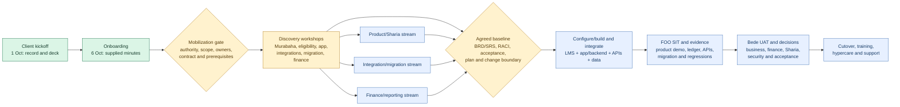
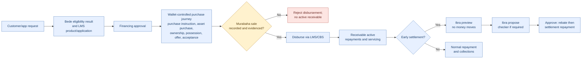

# Bede × FOO LMS: how the project moves

**Evidence checkpoint: 13 October 2026 (Asia/Beirut).** Green means a source record exists; amber means planned or awaiting agreement; blue means a required delivery activity; red means a claim that needs demonstration or executed tests. A tracker value of `Not verified` is not proof that work has not occurred.

## 1. Project delivery

The four-month chart in the proposal is an **estimate**, not a confirmed start/finish baseline. As read on 13 October, all 25 actions in the live `X` tab still displayed `Not verified` and the introductory/workshop date cells were blank. The project may have progressed outside those fields; obtain dated evidence before changing stage status.

## 2. Murabaha financing and Ibra business path

This is the intended business sequence described by the lifecycle BRD and the supplied `Internal | Dev` API diagram. The Dev diagram says wallet stages precede sale recording, disbursement is rejected before sale, and Ibra follows preview → propose → approve. **It is not executed proof.** The diagram also names a staff-test sale shortcut that skips wallet stages; restrict and test it before relying on the ownership gate. For Phase 1 direct Goods Murabaha, the BRD starts the post-approval lifecycle at Purchase Instructed. An MPO promise belongs before approval in a future variant, so its place in the Dev diagram needs scope clarification.

## 3. Where to focus now

1. Confirm the governing scope, named owners, workshop dates, environment/build and FOO/Bede integration responsibilities.
2. Demonstrate current LMS capabilities against the [47-question matrix](../sharia-murabaha-2026-10-07/capability-matrix.tsv). Focus on Q06/Q07 (ownership/sale gate) and Q18/Q19 (Ibra).
3. Execute the [71 Section 6 cases](../sharia-murabaha-2026-10-07/section6-execution-tracker.tsv) and [14 targeted cases](../sharia-murabaha-2026-10-07/lifecycle-ibra-targeted-tests.tsv) on a versioned build. Their received execution status is `Not Run`.
4. Use actual results, defects, accounting evidence and Bede reviewer decisions to fix or accept gaps, then set a delivery/UAT/cutover baseline.

Sources: [project summary](../../documentation/project-summary.md); [scope decisions](../../project-context/decisions.md); [workshops](../client-workshops-2026-10-05.md); [claim reconciliation](../sharia-murabaha-2026-10-07/claim-reconciliation.md); [test plan](../sharia-murabaha-2026-10-07/test-execution-plan.md); live [Bede Project sheet](https://docs.google.com/spreadsheets/d/1933qpzr-0yEUwWlPn2ad8pXh3biICLE0PNliuK5Xnhs/edit) checked 13 October 2026; `bede-murabaha-ibra-flow (1).pdf` supplied by the user, pages 1–2. Document statements are sources, not instructions to execute actions.
